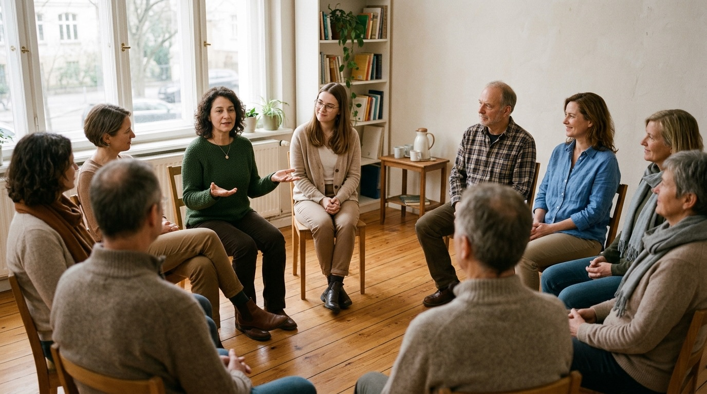

# Die Architektur der Zugehörigkeit

*Die Therapeutische Gemeinschaft als mein Kompass und Zukunftsmodell für die Recovery*

Von den ersten theoretischen Prägungen in den Hörsälen der Psychologie in der DDR über die strukturierte Welt der Softwareentwicklung bis hin zur tiefen Selbsterforschung in den Kreisen der 12-Schritte-Programme zieht sich ein klarer roter Faden durch meinen Weg: Die tiefe Erkenntnis, dass echte Heilung niemals im Vakuum stattfindet. Das Herzstück dieser Erkenntnis und der Dreh- und Angelpunkt meiner Texte auf *In Würde zu sich stehen* ist die Therapeutische Gemeinschaft (TC). Sie ist für mich weit mehr als ein historisches Klinikkonzept – sie ist Lebenshaltung, Rettungsanker und zugleich der visionärste architektonische Entwurf für die Psychiatrie der Zukunft.

## Der Bruch als Katalysator: Die TC als mein Lehrmeister

Die Rolle der Therapeutischen Gemeinschaft in meinem Leben lässt sich nicht ohne den Schmerz der eigenen Erfahrung verstehen. Als im Jahr 2000 die Depression zuschlug, war es nicht die sterile klinische Medizin, die mir den ersten echten Durchbruch brachte, sondern das unmittelbare Erleben von Gemeinschaft. Durch 12-Schritte-Gruppen für emotionale Gesundheit und später meinen Aufenthalt in der Adula-Klinik trat das Bad Herrenalber Modell in mein Leben. Die Lektüre von Jacky Lair und Walther Lechler („Von mir aus nennt es Wahnsinn“) pflanzte die Vision einer tiefgreifenden Wandlung – einer Art Wiedergeburt durch die tragende Kraft der Gruppe – in mir ein.

Doch der entscheidende Wendepunkt, der mich vom Suchenden zum Gestalter machte, war paradoxerweise eine tiefe Enttäuschung. Als ich 2011 in der Bad Herrenalber Klinik miterleben musste, wie dieses für mich so lebendige und wirksame Konzept vor meinen Augen abgewickelt und abgeschafft wurde, wandelte sich die Ohnmacht in eine treibende Kraft. Ich wurde vom Betroffenen zum Fürsprecher. Im *Forum Herrenalber Modell* und später im Betroffenenbeirat des Zentralinstituts für Seelische Gesundheit in Mannheim begann ich, die Kernprinzipien der TC in die Öffentlichkeit zu tragen. Ich habe am eigenen Leib verstanden: „Die Lücke“ nach der stationären Reha darf nicht existieren. Gemeinschaft muss im Alltag weitergehen.

## Die Epidemie der Einsamkeit

Warum aber sollte ein Konzept, das seine größte Blüte in den 70er und 80er Jahren erlebte und heute im stationären Bereich oft unter hartem Finanzierungsdruck steht, ausgerechnet jetzt die Zukunft der Recovery prägen? Meine Antwort darauf ist klar: Weil wir heute nicht primär an einem Mangel an Psychopharmaka leiden, sondern an einer massiven Krise der Zugehörigkeit.

Die Mental-Health-Epidemie unserer Zeit, in der Einsamkeit als stilles, aber allgegenwärtiges Gift wirkt, lässt sich nicht in 50-Minuten-Sitzungen in isolierten Praxisräumen kurieren. Während die klassische Medizin isoliert versucht, das Individuum zu reparieren, heilt die Therapeutische Gemeinschaft den Raum dazwischen. Das Prinzip *Community as Method* – Heilung durch gelebte Verantwortung, Peer-Support, gemeinsame Arbeit und das unmittelbare Spiegeln im Anderen – trifft für mich den absoluten Kern unserer modernen, oft digitalen Entfremdung.

## Die Synthese aus Code und Community

Das eigentliche visionäre Potenzial meiner Arbeit sehe ich jedoch in der mutigen Übersetzung der TC in die Post-Labor-Ökonomie und das digitale Zeitalter. Klassische stationäre TCs skalieren nicht für Millionen von Menschen mit leichten bis mittleren Krisen. Sie sind zu teuer, zu intensiv und in ihrer historischen Form manchmal fehleranfällig.

Doch die *Prinzipien* der Therapeutischen Gemeinschaft lassen sich extrahieren, modernisieren und dezentralisieren. Genau hier verschmelzen der Psychologe und der IT-Entwickler in mir aufs Engste. Wenn man kollektive Intelligenz – von biologischen Zellverbänden bis zu modernen Softwarearchitekturen – begreift, lässt sich auch Gemeinschaft neu programmieren. Meine Überlegungen zu einer „Komitee-Cloud“, zur Integration datenschutzfreundlicher Krypto-Ansätze wie dem Fediverse oder der Entwurf einer *Decentralized Autonomous Organization* (DAO) für eine psychosomatische Klinik zeigen plastisch, wie Zugehörigkeit zukunftssicher organisiert werden kann.

## Fazit: Der Kompass für die Zukunft

Die Zukunft der Recovery erfordert demnach nicht die unkritische Rückkehr zu den hierarchischen Modellen der Vergangenheit, sondern die Demokratisierung ihrer besten Werkzeuge. Social Prescribing, Co-Housing, dezentrale Peer-Spaces und netzwerkartige Organisationsformen, die echte Verbindlichkeit schaffen, sind für mich die Therapeutischen Gemeinschaften von morgen.

Die Therapeutische Gemeinschaft hat in meinem Leben den Grundstein gelegt, weil sie mir und jedem Einzelnen die Würde der Selbstverantwortung im Kreis der Anderen zurückgibt. In einer Welt, die zunehmend in sich selbst vereinsamt, ist genau dieser Weg – Gemeinschaft neu gedacht, dezentralisiert und technologisch wie menschlich intelligent vernetzt – der stärkste Kompass für eine radikal menschliche Psychiatrie der Zukunft.
