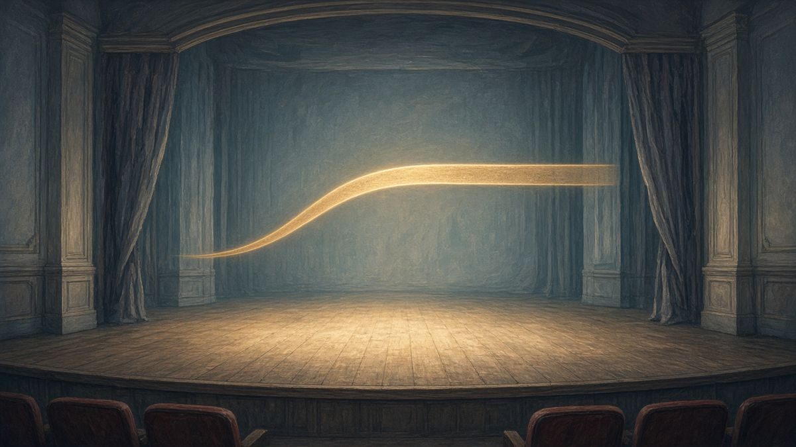
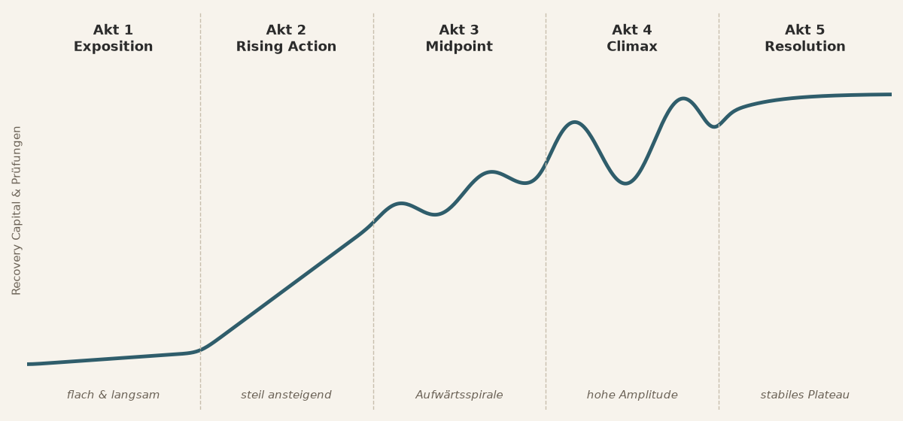

# Die Dramaturgie der Genesung

*Wie Recovery Capital und Antagonisten im „4th Turning“ skalieren – ein Denkmodell*

## Die Leitfrage

Stell dir vor, du schreibst das Drehbuch für deinen eigenen Genesungsweg. Und genau in dem Moment, in dem du dich am stärksten fühlst, wird dein Gegenspieler mächtiger. Ist das ein Fehler im System – oder gehört es zu echter Veränderung dazu?

Dieser Text spielt eine Idee durch: Genesung verläuft nicht als gerade Linie, sondern eher wie eine Geschichte mit Spannungsbogen. Innere Stärke und äußere Herausforderungen wachsen miteinander.

**Wichtig vorab:** Das hier ist ein *Denkmodell*, eine Metapher aus der Dramaturgie. Es ist kein wissenschaftlich belegtes Modell und ersetzt weder Therapie noch ärztliche Behandlung. Nimm es als Linse, durch die du auf deinen eigenen Weg schauen kannst – nicht als Landkarte, die für alle gilt.

## Die Regel aus der Dramaturgie

In der klassischen Dramaturgie gilt eine einfache Regel: *Die Bedrohung durch den Antagonisten wächst mit den Fähigkeiten des Protagonisten.* Nur so bleiben Spannung und Reifung erhalten. Eine Heldin, die neue Kräfte entwickelt, braucht größere Prüfungen – sonst bleibt die Geschichte stehen.

Übertragen auf Recovery heißt das: Am Anfang dominiert die *Illness-Identity*, die Krankheitsidentität. Das [Recovery Capital](/posts/recovery-capital/) – also die inneren und äußeren Ressourcen, die Genesung tragen – ist gering. Du reagierst eher hilflos und isoliert auf Symptome und die Angst vor sozialem Abstieg.

## Wenn die Zeiten rauer werden: das „4th Turning“

Den Begriff „Fourth Turning“ haben die Autoren William Strauss und Neil Howe geprägt. Gemeint ist eine Phase gesellschaftlicher Zuspitzung: Institutionen verlieren an Halt, die wirtschaftliche Lage wird instabil. Ob man dieser Geschichtstheorie folgt, ist eine eigene Frage – als Bild für die Gegenwart taugt sie.

In so einer Phase erweitert sich der Antagonist. Er besteht nicht mehr nur aus innerer Scham und Symptomen, sondern zunehmend aus äußeren Stressoren: Inflation, Entfremdung, Wirtschaftskrisen. Erst wenn du Ressourcen aufgebaut hast, werden diese Krisen nicht mehr als sofortiges Scheitern erlebt, sondern als Prüfungen, mit denen du umgehen kannst.

## Die fünf Akte

**Akt 1 – Exposition: Die Krankheitsidentität dominiert.**
Wenig Recovery Capital, kaum Kraft zum Bewältigen, viel Isolation. Das Tempo stockt. Symptome und Ausgrenzung überwältigen die wenigen Ressourcen.

**Akt 2 – Rising Action: Die drei Säulen entstehen.**
Über die Identitäts-Transition nach SIMOR (Social Identity Model of Recovery – kurz: der Wechsel von einer Krankheits- zu einer Recovery-Identität, getragen von einer Gruppe) und über 12-Schritte-Gruppen baust du Ressourcen auf:

- *Persönliches Capital:* Selbstwirksamkeit.
- *Soziales Capital:* Sponsorship, Dienst in der Gemeinschaft.
- *Finanzielles Capital:* erste kleine, automatisierte Sparraten.

Und der Antagonist reagiert: Stigma und Scham werden lauter. Das ist kein Rückschritt, sondern Teil des Bogens.

**Akt 3 – Midpoint: Die Aufwärtsspirale.**
Psyche und Alltag greifen ineinander. Emotionale Disziplin – „ein Tag nach dem anderen“ – und eine gelassene, geduldige Haltung im Umgang mit Geld verstärken sich. Größere äußere Schocks werden handhabbar.

**Akt 4 – Climax: Die größte Probe bei größter Fähigkeit.**
Deine Handlungsfähigkeit ist am größten – und die Bedrohung auch. Etwa wenn schwere gesellschaftliche Krisen auf letzte alte Identitätsmuster treffen. Hier zeigt sich, ob die Ausdauer trägt.

**Akt 5 – Resolution: Integrierte Resilienz.**
Die Recovery-Identität bleibt stabil, ohne neue Verengung. Das Tempo beruhigt sich auf ein nachhaltiges Maß aktiver Lebensgestaltung.

## Die Tempo-Kurve

Wenn du den Weg als Kurve zeichnest, sieht er etwa so aus:

- **Frühe Phase – flach und langsam:** Stabilisierung, Abstand gewinnen.
- **Mittlere Phase – steil ansteigend:** Schwung durch Dienst, Selbstwirksamkeit und finanzielle Handlungsfähigkeit.
- **Zuspitzung – hohe Amplitude:** große Ausschläge durch Krisen, aber mit mehr Tragfähigkeit.
- **Späte Phase – stabiles, höheres Plateau.**

Die Ausschläge verschwinden also nicht. Was sich ändert, ist, wie viel du tragen kannst.

## Die drei Säulen und eine Parallele

Ein Kerngedanke des Modells ist eine Parallele: In der 12-Schritte-Praxis und im Umgang mit Geld wird dieselbe Fähigkeit geübt – Geduld und das Aushalten von Schwankungen. Wer gelernt hat, emotionale Krisen „einen Tag nach dem anderen“ durchzustehen, kennt das Prinzip, das in Finanzkreisen manchmal „Diamond Hands“ genannt wird: nicht bei jeder Schwankung in Panik handeln.

Die drei Säulen stützen sich gegenseitig: Selbstwirksamkeit macht Gemeinschaft möglich, Gemeinschaft stärkt die Disziplin, finanzielle Ruhe nimmt Zukunftsangst.

**Ausdrücklicher Hinweis:** Dieser Text ist *keine Finanz- oder Anlageberatung* und keine Empfehlung für bestimmte oder riskante Anlagen. „Diamond Hands“ ist hier eine Metapher für Geduld, kein Anlagetipp. Setz nie alles auf eine Karte – ein *Klumpenrisiko* in hochvolatilen Vermögenswerten kann gerade in einer instabilen Lebensphase großen Schaden anrichten. Hol dir bei Geldfragen unabhängige, fachkundige Beratung.

## Wo das Modell aufhört

Jedes Bild hat Grenzen. Hier sind sie besonders wichtig:

**Akutversorgung geht immer vor.** Bei Suizidgedanken oder einer schweren seelischen Krise ist die Dramaturgie zweitrangig. Dann zählt nur eins: sofort Hilfe holen.

> **Wenn es dir gerade sehr schlecht geht:**
> Notruf **112** · TelefonSeelsorge **0800 111 0 111** oder **0800 111 0 222** (kostenlos, rund um die Uhr) · Ärztlicher Bereitschaftsdienst **116 117**

**Keine neue Verengung („Engulfment 2.0“).** Wer die Krankheitsidentität hinter sich lässt, sollte nicht in eine neue, dogmatische Totalidentität rutschen – weder durch ideologische Fixierung auf eine Gruppe noch durch finanzielle Fixierung auf hochriskante Anlagen. Recovery heißt Weite, nicht ein neuer Käfig.

## Fazit

In rauen Zeiten verläuft Genesung selten als gerade Erholung. Eher als Geschichte: Mit wachsendem Recovery Capital wachsen auch die Prüfungen – von innen und von außen. Tragfähig wird es durch die Verbindung von emotionaler Disziplin, sozialer Einbettung und einer ruhigen, verantwortlichen Handlungsfähigkeit.

Vielleicht hilft dir das Bild an einem schweren Tag: Dass der Gegenspieler stärker wird, heißt nicht unbedingt, dass du schwächer geworden bist. Manchmal heißt es, dass du gewachsen bist.

### Key Takeaways

- **Antagonistische Skalierung:** Herausforderungen wachsen mit deinen Fähigkeiten – Krisen werden von Lähmung zu Handlungsfeldern.
- **Drei Säulen:** persönliche Selbstwirksamkeit, soziales Engagement in der Gemeinschaft und finanzielle Handlungsfähigkeit stärken sich gegenseitig.
- **Parallele Volatilität:** „Ein Tag nach dem anderen“ und finanzielle Gelassenheit beruhen auf demselben Prinzip: Ausdauer.
- **Grenzen wahren:** Bei akuter Eigengefährdung hat professionelle Hilfe Vorrang. Ideologisierung und Klumpenrisiken vermeiden.

---

*Quellenhinweis: Dieser Text basiert auf einer KI-gestützten Notebook-Zusammenfassung bzw. Lektion von Thomas Richter („Die Dramaturgie der Genesung: Wie Recovery Capital und Antagonisten im 4th Turning skalieren“). Er ist ein Denkmodell und keine wissenschaftliche Studie, keine medizinische und keine Finanzberatung.*
