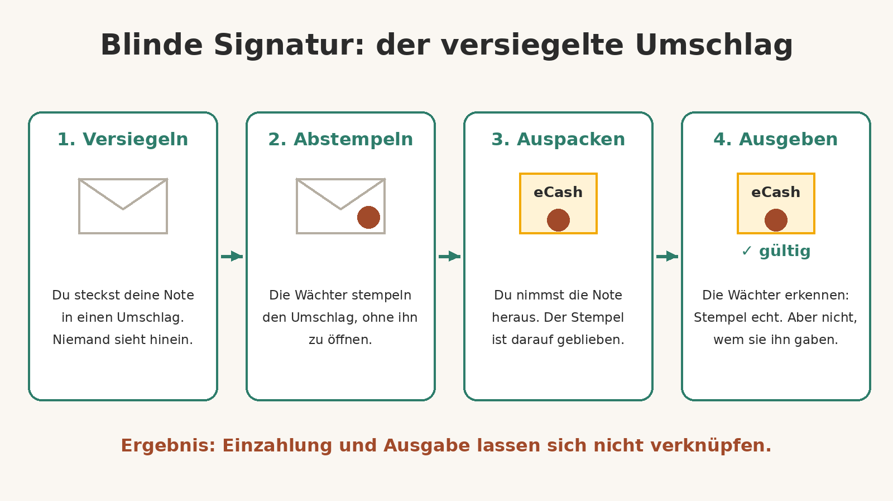
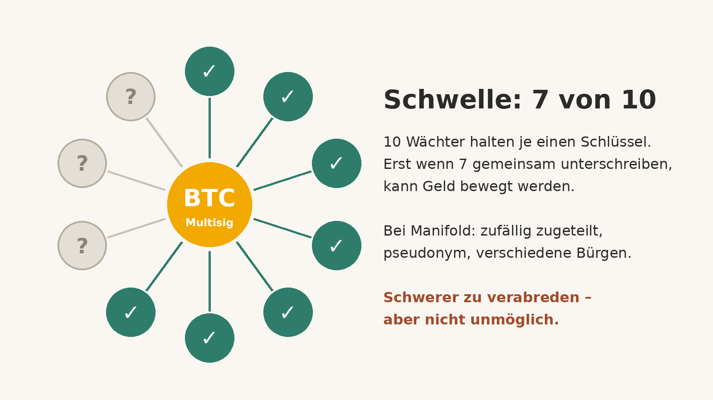
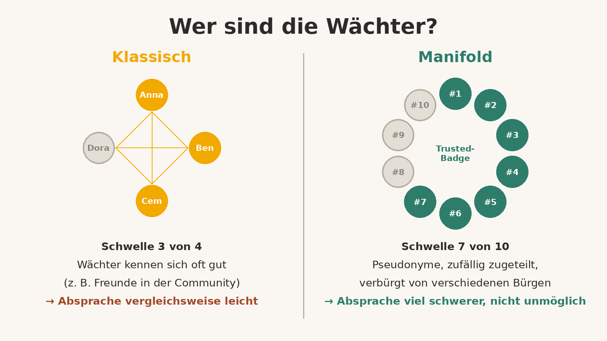

# Fedi und die Privatsphäre von Bitcoin

*Warum gemeinschaftliche Verwahrung mit eCash deine Zahlungen privater macht – und wer eigentlich auf die Wächter aufpasst*

## Das Problem: Bitcoin ist ein offenes Buch

Bitcoin gilt oft als „anonym“. Das stimmt leider nicht. Die Blockchain ist ein öffentliches Kassenbuch: Jede Transaktion – Betrag, Absender- und Empfängeradresse – ist für immer für alle einsehbar. Sobald eine deiner Adressen mit deinem Namen verknüpft ist, etwa weil du bei einer Börse mit Ausweis gekauft hast, lassen sich deine Zahlungen zurückverfolgen. Wer mit wem handelt, wer wen unterstützt, wer sich wofür organisiert – all das kann sichtbar werden.

Jeff Booth, Autor von *The Price of Tomorrow* und Board-Mitglied bei Fedi, bringt es so auf den Punkt: Bitcoin hat das schwerste Problem gelöst – Geld, das niemand entwerten, beschlagnahmen oder zensieren kann. Aber die Basisschicht ist *absichtlich* transparent. Und weil eigene Schlüssel für viele zu kompliziert sind, landen die meisten Menschen wieder bei einer Firma, die jede Bewegung sieht.

## Die Idee hinter Fedi: eCash mit blinden Signaturen

Fedi ist eine App, die auf dem offenen Protokoll **Fedimint** aufbaut. Statt dass eine einzelne Firma deine Bitcoin verwahrt, hält eine Gruppe – die **Föderation** – sie gemeinsam. Die Menschen, die die Server betreiben, heißen **Wächter** (Guardians).

So läuft es ab:

- Du zahlst Bitcoin bei der Föderation ein.
- Dafür bekommst du **eCash-Noten** – digitale Gutscheine, die einen Anspruch auf die Bitcoin der Föderation darstellen.
- Diese Noten werden mit **blinden Signaturen** ausgestellt, einem Verfahren, das der Kryptograf David Chaum Anfang der 1980er-Jahre erfunden hat. Booth vergleicht das mit einem Notar, der einen versiegelten Umschlag abstempelt, ohne ihn zu öffnen.
- Wenn du eine Note später ausgibst, können die Wächter prüfen, dass sie echt ist – aber nicht, wem sie einmal ausgestellt wurde.

Das Ergebnis: Die Wächter sehen weder deinen Kontostand noch, wen du bezahlst. Zahlungen innerhalb der Föderation laufen nicht über die Blockchain und hinterlassen dort keine Spur. Nach außen geht es über das **Lightning-Netzwerk**. Ganz spurlos ist das nicht: Dienste, die Lightning-Zahlungen weiterleiten, können am Rand der Föderation noch etwas mitbekommen.

## Wer passt auf die Wächter auf?

Hier wird es spannend – und ehrlich gesagt auch heikel. Denn das Geld liegt nicht mehr bei dir, sondern bei der Föderation.

Technisch ist das so gelöst: Die Bitcoin liegen in einer **Multisignatur-Wallet mit Schwelle**. Bei *n* Wächtern müssen *t* gemeinsam unterschreiben, damit Geld bewegt wird – laut Fedimint-Dokumentation eine Mehrheit, zum Beispiel 3 von 4 oder 5 von 7. Kein einzelner Wächter und keine Minderheit kann die Bitcoin allein bewegen. Zusätzlich stimmen sich die Server über ein Konsensverfahren (AlephBFT) ab, das auch dann korrekt weiterläuft, wenn eine Minderheit der Wächter ausfällt oder sich bösartig verhält.

Aber – und das sagt Booth selbst ganz offen: **Wenn genug Wächter zusammenarbeiten, könnten sie die Bitcoin stehlen.** Und es gibt ein zweites, leiseres Risiko: Weil eCash privat ist, könnte eine kolludierende Mehrheit mehr Noten ausgeben, als Bitcoin dahinterstehen. Das würde niemand merken – bis viele gleichzeitig auszahlen wollen. Eine versteckte Teilreserve, verborgen durch genau die Privatsphäre, die dich schützen soll.

## Stimmt es, dass sich die Wächter nicht kennen?

Oft hört man: Die Föderation kann nicht mit deinem Geld abhauen, weil sich die Wächter gar nicht kennen. Das ist **teilweise richtig – aber erst seit Kurzem, und nicht für jede Föderation.**

Booth beschreibt in seinem Artikel vom 22. Oktober 2026 selbst, wie es bisher war: Für echte Unabhängigkeit bräuchte man mindestens vier Leute, *idealerweise Menschen, die sich nicht kennen*, die jahrelang einen Server betreiben. Das konnten nur wenige Gemeinschaften stemmen. **Die meisten Föderationen wurden deshalb von Freunden betrieben, die sich gut kannten – genau die Konstellation, in der Absprachen am leichtesten sind.** In klassischen Föderationen kennen sich die Wächter also meist, und die Fedi-Hilfeseiten nennen „die Wächter persönlich kennen“ sogar ausdrücklich als einen Weg, Vertrauen aufzubauen.

Die Antwort darauf heißt **Manifold** – Fedis neues Verfahren, Föderationen aufzusetzen, aufbauend auf dem offenen Protokoll **PeerBadge**:

- **Nur geprüfte Betreiber:** Jeder Wächter braucht ein PeerBadge der Stufe „Trusted“. Ein echter Mensch bürgt dafür, dass da eine echte, einzigartige, vertrauenswürdige Person dahintersteht – per teilweise blinder Signatur, ohne dass eine Verbindung zwischen Bürge und Schlüssel gespeichert wird.
- **Eine Person, ein Sitz:** Niemand kann heimlich mehrere Wächter-Plätze einer Föderation besetzen.
- **Niemand sucht sich seine Partner aus:** Die Wächter werden automatisch zugeteilt, die Kandidatenliste wird jedes Mal neu gemischt, und die Plätze werden auf Betreiber verteilt, für die *verschiedene* Bürgen unterschrieben haben.
- **Pseudonym:** Wächter treten nur unter Pseudonym auf.
- **Höhere Schwellen:** Manifold-Föderationen haben sieben oder mehr Wächter, empfohlen sind zehn. Bei zehn Wächtern müssen sieben unterschreiben.

Booths Fazit: Für einen Diebstahl müssten sieben Betreiber, die sich nie gegenseitig ausgesucht haben und sich nur unter Pseudonym kennen, *sich erst finden* und sich dann auf den Betrug einigen – und jeder riskiert dabei ein Badge, für das ein echter Mensch gebürgt hat. „Das ist ein ganz anderes Problem als drei Freunde, die beschließen, in die Kasse zu greifen“, schreibt er sinngemäß.

Die These „ohne wechselseitiges Wissen“ beschreibt also ziemlich genau das **neue Manifold-Design**. Aber: Das Schutzprinzip ist nicht die Unwissenheit allein. Es ist die Kombination aus **Schwellen-Kryptographie** (eine große Mehrheit muss mitmachen), **Unabhängigkeit** (zufällige Zuteilung, verschiedene Bürgen) und **Reputation** (ein Badge, das man verlieren kann).

## Das Restrisiko bleibt

Booth sagt es selbst, und Manifolds eigene Bedingungen auch: Das Design macht Absprachen **viel schwerer, aber nicht unmöglich**. Sieben von zehn Wächtern, die kolludieren, können das Geld technisch nehmen oder ungedecktes eCash ausgeben. Dazu kommen praktische Risiken: Gehen zu viele Wächter offline, ist das Geld eingefroren, bis sie zurück sind. Und zum Start ist laut Fedi-Support Fedi selbst der einzige Liquiditätsanbieter für Manifold-Föderationen.

Wichtig, falls du Fedi schon nutzt: Ältere sogenannte **G-Bot-Föderationen** werden laut Fedi-Blog vom 6. November 2026 geschlossen. Prüf in deiner App, ob dich das betrifft, und zieh dein Geld rechtzeitig ab.

Booths eigene Empfehlungen sind bodenständig:

- Nutze Fedi wie eine **Alltagsgeldbörse**, nicht als Tresor. Halte nur Beträge, die für eine Geldbörse Sinn ergeben.
- **Verteile** dein Geld auf mehr als eine Föderation.
- **Teste regelmäßig:** Zieh Geld ab und zahl es wieder ein. Eine Föderation, die Auszahlungen nicht bedienen kann, fällt schnell auf.

Für größere Ersparnisse bleibt die Selbstverwahrung mit eigenen Schlüsseln der sicherere Weg.

## Fazit

Fedi löst das Privatsphäre-Problem von Bitcoin nicht vollständig, aber deutlich: Mit Chaumschem eCash sehen nicht einmal die Wächter, wer wem wie viel zahlt. Der Preis ist Vertrauen – nicht in eine Firma, sondern in eine Gruppe. Mit Manifold versucht Fedi, diese Gruppe so zusammenzusetzen, dass Absprachen gegen dich möglichst schwer werden: geprüfte, einander unbekannte Fremde, zufällig zugeteilt, mit hoher Schwelle.

Für eine Gemeinschaft wie unsere ist das ein interessanter Gedanke: Vertrauen, das nicht auf Kontrolle beruht, sondern auf Struktur. Aber auch hier gilt – kleine Schritte, gesunde Skepsis, nicht alles auf eine Karte.

**Ausdrücklicher Hinweis:** Dieser Text ist *keine Finanz- oder Anlageberatung* und keine Empfehlung für bestimmte Produkte oder Anlagen. Bitcoin ist hochvolatil. Hol dir bei Geldfragen unabhängige, fachkundige Beratung. Zur Transparenz: Jeff Booth sitzt im Board von Fedi und ist über Ego Death Capital an Fedi beteiligt, wie er selbst offenlegt.

---

### Quellen

- Jeff Booth: [Private money, private conversation, and how Fedi is solving the guardian problem](https://www.jeffreybooth.com/articles/private-money-private-conversation), 22. Oktober 2026
- Fedimint-Dokumentation: [How Federations Work](https://fedimint.org/guardians/how-federations-work)
- Fedi-Blog: [Community Custody: A Way to Hold Bitcoin Without Carrying All the Risk Yourself](https://www.fedi.xyz/blog/community-custody-a-way-to-hold-bitcoin-without-carrying-all-the-risk-yourself)
- Fedi Support: [What are the roles in a Manifold federation?](https://support.fedi.xyz/hc/en-us/articles/38834761003666-What-are-the-roles-in-a-Manifold-federation)
- Fedi Support: [How do I know which federations I can trust?](https://support.fedi.xyz/hc/en-us/articles/28746167954194-How-do-I-know-which-federations-I-can-trust)
- Fedi-Blog: [Important Update: Migrate Your G-Bot Federations](https://www.fedi.xyz/blog/important-update-migrate-your-g-bot-federations), 6. November 2026
