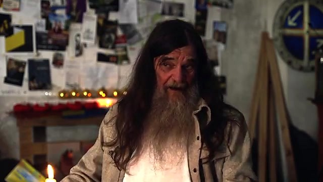
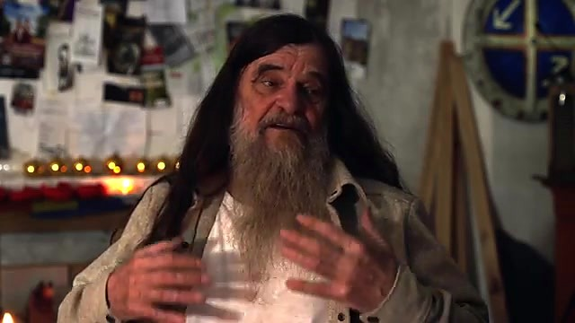
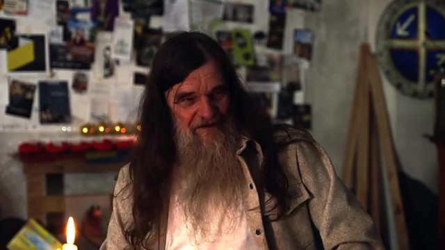
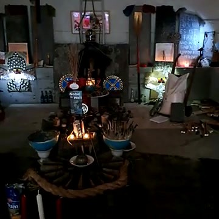
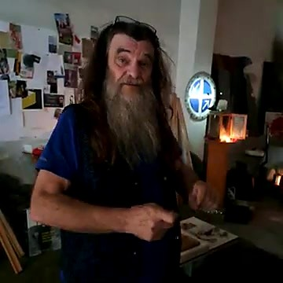
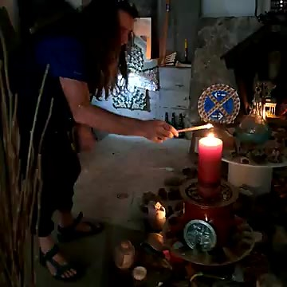
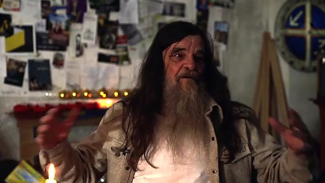

# Was uns Ketan für die Post-Labor-Economy geben kann

*Wenn bezahlte Arbeit ihre zentrale Rolle verliert, bleibt die Frage nach Sinn, Würde und Gemeinschaft. Ein Gespräch mit Ketan Tepel gibt darauf eine ungewöhnliche Antwort.*

*Ketan Tepel in seinem Atelier in Mühlhausen, das zugleich die Weltfried Akademie beherbergt. Standbild aus dem Gespräch [„Ketan Tepel: Ohne Geld, für den Frieden – zu Fuß durch Ostdeutschland“](https://www.youtube.com/watch?v=Rgrtc5B4R3s) (Ins Wesentliche, YouTube, 8. November 2026)*

Am 8. November 2026 hat Constantin Dahms auf seinem Kanal Ins Wesentliche ein zweites Gespräch mit Ketan Tepel veröffentlicht. Es entsteht in einer Doppelgarage in Mühlhausen: Atelier und, wie Ketan sie nennt, „Allerheiligstes der Weltfriedensakademie“. Ketan ist seit Jahrzehnten zu Fuß unterwegs, oft ohne Geld, immer wieder Richtung Osten. Im Westen, erzählt er, sei er auf seiner Wanderung kein einziges Mal eingeladen worden. Im Osten brach eine Frau in Tränen aus, weil zwei Männer aus dem Westen sie nicht ausrauben wollten.

Ich habe das Gespräch nicht als politischen Kommentar gehört. Ich habe es als Frage gehört, die uns in einer anderen Debatte schon beschäftigt: Was bleibt von Würde, Identität und Gemeinschaft, wenn der Job nicht mehr der Mittelpunkt ist?

## Was Post-Labor Economy meint

In [Recovery und Post-Labor Economics](/posts/recovery-post-labor/) habe ich das Modell des Autors David Shapiro beschrieben. Shapiro geht davon aus, dass künstliche Intelligenz und Automatisierung menschliche Arbeit als begrenzenden Faktor der Produktion weitgehend zurücktreten lassen. Wachstum und Wohlstand könnten sich dann von der Lohnarbeit entkoppeln. Seine Leitfrage lautet: Wie kommt Geld in die Haushalte, wenn Löhne wegbrechen?

Das ist ein Entwurf, keine Prognose. Entscheidend ist die Richtung: Würde soll nicht mehr allein am Verkauf der eigenen Zeit hängen. Genau dort wird Ketans Leben interessant. Nicht weil er ein Wirtschaftstheoretiker wäre, sondern weil er seit nahezu fünfzig Jahren praktiziert, was viele erst für die Zukunft diskutieren: ein Leben, das sich nicht um den Job dreht.

## Wer Ketan ist

Ketan Tepel, mit bürgerlichem Namen Rolf Tepel, stammt aus dem Kölner Raum. 1980 hat er, so berichten zeitgenössische Porträts, den Kreislauf aus Arbeit, Essen, Schlafen und ein wenig Freizeit verlassen. Er lebte lange im Zirkuswagen, ohne Kontonummer und ohne Versicherung, und rollte 1993 einen Stein zu Fuß durch Deutschland: ein symbolischer Akt, den Stein ins Rollen zu bringen.

Im Gespräch sagt er: Mit der Schulbildung und dem Arbeitsleben habe er abgeschlossen, weil er dort nichts mehr für sich gefunden habe. Dann die Eingebung, loszuwandern, der aufgehenden Sonne entgegen, Richtung Osten.

*Ketan im Gespräch. Standbild aus [dem Video von Ins Wesentliche](https://www.youtube.com/watch?v=Rgrtc5B4R3s)*

Er weist den Vorwurf zurück, ein Schmarotzer zu sein. Schräger könne man nicht liegen. Er habe sich in seinem Leben darum bemüht, mit Mitmenschen zu leben. Und dann der Satz, der für mich der Schlüssel ist: „Ich lebe übrigens auch nicht von meiner Kunst, sondern ich lebe mit meiner Kunst oder mit meinem Schaffen.“ Das einzige, was bei ihm anders sei: „Ich laufe nicht dem Geld hinterher, ich laufe auch nicht der Luft hinterher oder dem Wasser hinterher.“

Das ist keine Romantik vom Aussteigen. Ketan hat, wie er selbst sagt, auch gehungert. Ein Jahr lang ist er ohne Geld durch Deutschland gewandert. Erst wer sein Existieren vom Geld unabhängig gemacht habe, könne überhaupt eine Vorstellung davon entwickeln, „was das Geldwesen, so wie es ist, mit uns allen anrichtet.“

## Die Begegnung, die man nicht kaufen kann

Hier liegt für mich die erste Lehre für eine Gesellschaft nach der Lohnarbeit.

Geld, sagt Ketan, bedeutet oft: „Ich kaufe mir die nächste Begegnung.“ Man hat Hunger, man hat Kohle, man bekommt das Brötchen, und mehr muss nicht gesagt werden als „guten Tag, auf Wiedersehen, brauchen Sie noch eine Quittung“. Verzichtet man darauf, die Begegnung zu kaufen, werde die Welt „sofort eine kommunikative“. Dann muss man sich vorstellen, den eigenen Weg erzählen, Fähigkeiten anbieten – das Klo putzen, einen Einkauf erledigen, ein Dach decken – und fragen, was der andere braucht. Die Anonymität hebt sich auf. Man spricht über das, was fehlt, und über das, was man zu viel hat und geben kann. Daraus, sagt er, entstehe „eine Art Einigkeit“.

Das trifft einen Punkt, den Shapiro mit der „Meaning Economy“ nur andeutet: Bedeutung entsteht nicht von selbst, nur weil Maschinen mehr produzieren. Fiele der Job als Mitte weg, wäre die Gefahr nicht nur materiell. Es wäre die Leere, in der niemand mehr einen Grund hat, aufeinander zuzugehen. Ketan dreht das um. Ohne das Geld als Abkürzung bleibt nur der Kontakt – nicht als Ideologie, sondern als Notwendigkeit, aus der Beziehung wachsen kann.

In der therapeutischen Gemeinschaft kenne ich etwas Ähnliches, auch wenn die Herkunft eine andere ist. Gemeinschaft ist dort die Methode, nicht die Pause nach der Behandlung. Man hat etwas zu geben, auch ohne Status auf dem Arbeitsmarkt. Ketans „Einigkeit“ ist kein Klinikmodell. Aber Würde entsteht oft dort, wo Menschen einander brauchen und einander etwas anbieten können – nicht nur dort, wo sie einander bezahlen.

## Die Kartoffeln in der kalten Garage

*Ketan erzählt von einer Nacht in einer kalten Garage, in der ein paar gefundene Kartoffeln zum Fest wurden. Standbild aus [dem Video von Ins Wesentliche](https://www.youtube.com/watch?v=Rgrtc5B4R3s)*

Die zweite Lehre ist noch schlichter, und sie hat mich am längsten festgehalten.

Auf der Wanderung mit dem rollenden Stein 1993 und 1994, erzählt Ketan, seien die Leute plötzlich verschlossen gewesen. Am Abend fanden er, sein zehnjähriger Sohn und ein Mitwanderer mit Mühe eine Garage. Es war kalt, sie hatten nichts mehr zu essen. Der Junge bekam Panik. Der Mitwanderer war emotional labil: Mit Beginn der Wanderung hatte er das Trinken aufgegeben, das er jahrelang geübt hatte. Ketan ist herumgegangen, hat nebenan auf einem Acker übrig gebliebene Kartoffeln gefunden, Wasser, einen Topf, ein wenig Salz. Sie haben die Kartoffeln gekocht.

„Diese Kartoffeln in der Situation“, sagt er, „die haben wir gefeiert.“ Ein größeres Fest könne es gar nicht geben. Und dann die Diagnose, die über diese eine Nacht hinausweist: „Wir gehen kaputt an unserem Zuviel von allem.“ Vor lauter Wertanhäufung sei die Wertschätzung auf dem Nullpunkt. „Wir ersticken an Überfluss.“

Ich will das nicht verklären. Hunger ist keine Therapie, und eine kalte Garage ist kein gesellschaftliches Modell. Ketan beschreibt den Mangel als Erfahrung, die ihn weniger erpressbar gemacht habe: nicht verlogen werden zu müssen, nur um an das nächste Brötchen zu kommen. Freiheit meint bei ihm nicht Komfort. Sie meint, die Erpressbarkeit aus dem Leben herauszuhalten.

Für die Post-Labor-Economy ist das Warnung und Hoffnung zugleich. Wenn der äußere Überfluss wächst, während die Wertschätzung schwindet, wird aus Entlastung keine Würde. Sinn hängt nicht am Zuviel. Er kann in einer geteilten Mahlzeit liegen, in einer Nacht, in der niemand allein bleibt. Dass auf jener Wanderung jemand mitging, der gerade aufgehört hatte zu trinken, gehört für mich dazu. Gemeinschaft hält, gerade wenn jemand seinen Weg neu beginnt. Das kenne ich aus der Genesung.

## Würde ohne Lohnzettel

Im Seminar, das ich anbiete, und auf dieser Seite heißt das: In Würde zu sich stehen. Man steht zu seiner Geschichte, ohne dass der Job, die Leistung oder die Opferrolle die ganze Identität bleiben darf. Ketan wird als Schmarotzer beschimpft, weil er nicht dem Geld hinterherläuft. Seine Antwort ist nicht eine neue Rolle im alten Spiel. Sie ist die Behauptung, dass ein Mensch mit und für andere leben kann, ohne sich über den Verkauf seiner Zeit zu definieren.

Genau das wird eine Gesellschaft üben müssen, in der bezahlte Arbeit an Gewicht verliert. Sonst bleibt nur, was wir in dem früheren Beitrag die Anstalt ohne Mauern genannt haben: versorgt werden, ohne dazuzugehören. Ketan ist kein Rezept dafür, wie Haushalte in Zukunft Einkommen sichern. Das bleibt die politische Frage, die Shapiro stellt. Ketan stellt eine andere, die ebenso schwer wiegt: Wie begegnen wir uns, wenn wir uns die Begegnung nicht mehr kaufen?

## Die Wiedereröffnung des Werk-Ateliers

Zwei Monate vor dem Gespräch mit Constantin Dahms hat Ketan selbst ein kurzes Video veröffentlicht. Am 13. September 2026 erschien auf dem Kanal der WeltFriedAkademie der Film „Das neue WerkAtelier der WeltFriedAkademie ist hiermit eröffnet!“ Es sei ein Geschenk zu seinem 70. Geburtstag, sagt er: die Wiedereröffnung seiner Werkstatt. Elf Jahre zuvor sei sie ihm, so seine Worte, „im Namen des Volkes“ von der Stadt Köln „entwendet und vernichtet“ worden. Jetzt hat er sie nach Ostdeutschland verlegt und in ein „Garagen-Startup“ verwandelt. Früher sei alles unter freiem Himmel gewesen. Diesmal nimmt er sich, halb im Scherz, die Legende derer zum Vorbild, die in einer Garage angefangen haben.

*Das neu eingerichtete Werkstattatelier in einer Garage in Ostdeutschland. Standbild aus [„Das neue WerkAtelier der WeltFriedAkademie ist hiermit eröffnet!“](https://www.youtube.com/watch?v=aVWtAMiSvxA) (WeltFriedAkademie, YouTube, 13. September 2026)*

In einem Raum hat er arrangiert, was ihm in seinem Leben wert ist und was er angesammelt hat. Er nennt ihn das Werkstattatelier der Weltfriedenakademie: einen Denkraum, der sich „abgekoppelt hat von allen Kriegsgedanken“, um den Fried zu bedenken. „Heute ist der Eröffnungstag.“ Willkommen sei, wen das Sprechen und Denken über Friedensfragen interessiert. Der einsame Friedensdenker, sagt er, solle sich multiplizieren, im besten Fall zu einer permanenten Weltfriedenskonferenz.

*Ketan Tepel bei der Eröffnung. Standbild aus [dem Video der WeltFriedAkademie](https://www.youtube.com/watch?v=aVWtAMiSvxA)*

Um dem Ganzen ein Licht anzuzünden, entzündet er eine dicke Kerze, die monatelang auf diesen Moment gewartet hat. Stängel aus dem Paradies – „wo sich die erste Friedensakademie befunden hat“ – taugen nicht als Streichholz. Er nimmt das Umrührhölzchen vom Morgenkaffee. Die Weltfriedenakademie sei immer auch ein Labor, sagt er. Die Kerze brennt für den Fried, für die Akademie und für die Einweihung der Werkstatt. Dann wendet er sich nach Osten, Süden, Westen und Norden. Damit sei die Einladung „in Form von Licht und Wärme“ ausgesprochen. Zum Schluss spielt er auf der Friedharfe.

*Ketan entzündet die dicke Kerze zur Einweihung. Standbild aus [dem Video der WeltFriedAkademie](https://www.youtube.com/watch?v=aVWtAMiSvxA)*

Genau dieser Raum ist es, in dem später das Gespräch mit Constantin Dahms entsteht: die Doppelgarage in Mühlhausen. Für die Frage nach einer Zeit nach der Lohnarbeit ist das Atelier mehr als eine Kulisse. Es ist ein Ort, an dem Werk und Begegnung zusammenkommen, ohne dass ein Job der Anlass sein müsste. Ein selbst gegebenes Geschenk, ein offener Denkraum, eine Einladung.

Das Video der Eröffnung ist hier zu sehen: [Das neue WerkAtelier der WeltFriedAkademie ist hiermit eröffnet!](https://www.youtube.com/watch?v=aVWtAMiSvxA).

## Was bleibt

*Ketan spricht über seine verbliebene Aufgabe: eine Friedenserklärung, die so ernst genommen wird wie eine Kriegserklärung. Standbild aus [dem Video von Ins Wesentliche](https://www.youtube.com/watch?v=Rgrtc5B4R3s)*

Ketan sagt, er habe nur noch eine Aufgabe: nicht ins Grab zu steigen, bevor eine Weltfriedenserklärung wirklich in der Welt ist. Sein Zielpunkt ist das Jahr 2033, ein Friedensjahr, in dem der Fried wieder zur Rechtsgrundlage des Miteinanders werden soll. Das Wort „Fried“, sagt er, existiere in unserer Sprachwelt als Substantiv „nur auf dem Friedhof oder als Störenfried“. Dabei gehöre der Fried zusammen mit Freude und Freundschaft. Dass wir freundlich sind mit der Erde, mit dem Mitmenschen, mit der Materie, die uns die Erde gibt: Daraus entstehe eine andere Welt.

Das Gespräch enthält auch scharfe, streitbare Sätze über Ost und West, über aktuelle Kriege und über Schuld nach der Wende. Die nehme ich als seine Sicht wahr, nicht als mein politisches Programm. Mich interessiert etwas anderes: Ketan hat sich einen Sinn gegeben, der nicht vom Arbeitsmarkt abhängt. Ob man sein Ziel teilt oder für größenwahnsinnig hält – er selbst spricht den Einwand aus –, es zeigt, dass Identität an einer Aufgabe wachsen kann, die kein Arbeitgeber vergibt.

Wir müssen Ketans Leben nicht kopieren, um davon zu lernen. Wenn die Post-Labor-Economy mehr sein will als eine Verteilungsmaschine, braucht sie genau das, was er in der Garage und auf der Straße geübt hat: Kontakt statt Anonymität, Wertschätzung statt bloßer Wertanhäufung, eine Würde, die nicht am Lohnzettel hängt, und eine Gemeinschaft, in der man einander etwas zu geben hat. Das ist keine fertige Ökonomie. Es ist eine Haltung. Und Haltungen kann man üben, bevor die Zukunft eintrifft.

Das Gespräch ist hier zu sehen: [Ketan Tepel: Ohne Geld, für den Frieden – zu Fuß durch Ostdeutschland](https://www.youtube.com/watch?v=Rgrtc5B4R3s).

---

### Quellen

- Constantin Dahms / Ins Wesentliche: [Ketan Tepel: Ohne Geld, für den Frieden – zu Fuß durch Ostdeutschland](https://www.youtube.com/watch?v=Rgrtc5B4R3s), YouTube, 8. November 2026. Die Zitate folgen dem gesprochenen Gespräch; kleine Glättungen gleichen nur offensichtliche Versprecher und Fehler der automatischen Untertitel aus.
- Die Standbilder stammen aus diesen beiden Videos; die Rechte liegen bei der jeweiligen Produktion.
- WeltFriedAkademie: [Das neue WerkAtelier der WeltFriedAkademie ist hiermit eröffnet!](https://www.youtube.com/watch?v=aVWtAMiSvxA), YouTube, 13. September 2026. Die Angaben zur Wiedereröffnung und die Zitate folgen diesem Film; kleine Glättungen gleichen nur offensichtliche Fehler der automatischen Untertitel aus.
- Kontaktwege zu Ketan nennt die Videobeschreibung, unter anderem [WeltFriedAkademie](https://www.youtube.com/@weltfriedakademie3021) und [ketan@stein-des-anstosses.de](mailto:ketan@stein-des-anstosses.de).
- Zur Biografie, soweit sie über das Gespräch hinausreicht: Julia Naumann, [„Anecken mit gerollten Steinen“](https://taz.de/Anecken-mit-gerollten-Steinen/!1601537/), *taz*, 6. September 1993; [„Der Sisyphos vom Eifelwall“](https://taz.de/Der-Sisyphos-vom-Eifelwall/!379418/), *taz*, 15. September 2006.
- David Shapiro: [What do I mean when I say „Post-Labor Economics“ anyways?](https://daveshap.substack.com/p/what-do-i-mean-when-i-say-post-labor), 17. November 2024; [The 7 Frameworks to Understand Post-Labor Economics](https://daveshap.substack.com/p/the-7-frameworks-to-understand-post), 18. März 2026.
