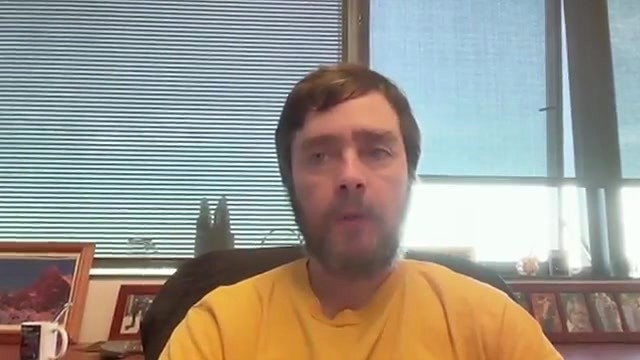

# Ein Recovery-Space: Was uns Michael Levin über Identitätswandel in der Gemeinschaft zeigen kann

*In der Therapeutischen Gemeinschaft entsteht ein Raum, in dem sich nicht nur das Verhalten ändert, sondern die Identität. Ein Gespräch mit dem Biologen Michael Levin gibt dieser Erfahrung eine unerwartete Sprache. Es bleibt eine Analogie – und gerade als solche ist sie präzise.*

*Michael Levin im Gespräch [„Does a town have goals of its own?“](https://www.youtube.com/watch?v=t_Yhcd52LHo) (Science Conversations, YouTube, 28. Oktober 2026)*

Ende Oktober 2026 ist auf dem Kanal Science Conversations ein knapp fünfzigminütiges Gespräch mit Michael Levin erschienen, Biologe an der Tufts University. Er forscht daran, wie Zellen kommunizieren, Körper bauen und reparieren, und was sich daraus über Intelligenz sagen lässt. Die Titelfrage lautet: Kann eine Stadt Ziele haben, die niemand in ihr einzeln vertritt?

Levin spricht nicht über Sucht, nicht über Genesung und nicht über Therapeutische Gemeinschaften. Was folgt, ist meine Lesart, keine Ableitung aus seinem Labor. Ich lege sie offen, weil mich viele Erfahrungen in der A-Gemeinschaft rund um Bad Herrenalb und in den Zwölf-Schritte-Gruppen nicht loslassen: dass Gemeinschaft selbst ein Raum sein kann, in dem sich ein Mensch neu organisiert. Einen solchen Raum nenne ich hier Recovery-Space.

## Nicht die beschädigte Person, das verletzte Muster

Die These, der dieser Text nachgeht, lautet: In der Therapeutischen Gemeinschaft gibt es einen Recovery-Space, in dem sich verletzte Selbstmuster durch einen Identitätswandel so umordnen, dass jemand wieder als lebendiges Glied einer Gesellschaft teilhaben und innere Ressourcen aufbauen kann.

Ich setze die Worte „deformierte Seelen“ und „dysfunktional“ in Anführungszeichen, wo sie in der Ausgangsformulierung stehen. Sie treffen etwas, wenn sie ein verwundetes, verhaktes Selbstmuster meinen. Sie treffen nichts, wenn sie den Menschen selbst zum defekten Teil erklären. Die Würde liegt nicht darin, wieder zu funktionieren. Sie liegt darin, zu sich zu stehen und weiterzugehen. Genau das ist für mich der Kern von „In Würde zu sich stehen“: so heißt das Seminar, das ich anbiete, und so heißt diese Seite.

George De Leon hat das genauer gesagt. In der Therapeutischen Gemeinschaft ist Genesung mehr als das Ende des Konsums. Sie ist ein Entwicklungsprozess, in dem soziale und psychologische Ziele zusammenkommen: eine veränderte Lebensweise und eine positive persönliche und soziale Identität. „Right living“, das aufrichtige Leben, meint Wahrhaftigkeit, Verantwortung für die eigene Gegenwart, Arbeit, Rechenschaft und Sorge für die anderen. Nüchternheit ist Voraussetzung, um so zu leben. So zu leben ist nötig, um nüchtern zu bleiben.

## Nicht die Regel, die Beziehung

Levin unterscheidet Systeme danach, wie man sie beeinflussen kann. Sein Spektrum der Beeinflussbarkeit reicht von der mechanischen Uhr, bei der man die Zahnräder bewegt, über den Thermostat mit seinem Sollwert bis zum Menschen, dem man ein Argument gibt. Je weiter man auf diesem Spektrum nach oben kommt, desto weniger muss man das Innere kennen – und desto weniger tragen feste Regeln.

Regeln, sagt er, seien ein Formalismus, der „am unteren Ende des Spektrums der Beeinflussbarkeit besser funktioniert“. *(Übersetzung, 6:20.)* Irgendwann müsse man von Regeln zu Motivationen, Zielen, Vorannahmen, Stress und Vorlieben übergehen, „um mit deinem System eine sinnvolle Interaktion zu haben“. *(Übersetzung, 7:28.)* Am oberen Ende der Kurve sei es „nicht Regeln, und es ist nicht Training, und es ist nicht eines von den Dingen der Verhaltenswissenschaft. Es ist eher so etwas wie Psychoanalyse, im Grunde, und Liebe und Freundschaft und solche Dinge.“ *(Übersetzung, 11:34.)* Wer dafür Regeln aufschreiben wolle, werde öfter scheitern als Erfolg haben.

Das ist keine Anleitung für die Klinik. Es trifft aber etwas, das ich in der Lehr-Lern-Gemeinschaft erlebt habe. Eine Therapeutische Gemeinschaft hat Regeln, und sie braucht sie. Aber die Regel allein ändert niemanden. De Leons „community as method“ meint gerade das: Die Gemeinschaft selbst ist die Methode, nicht nur der Rahmen für eine Technik. Veränderung entsteht im gemeinsamen Leben, in dem jeder Verantwortung trägt, Rückmeldung gibt und annimmt. Am oberen Ende, um Levins Bild aufzunehmen, wirkt nicht die Vorschrift, sondern die Beziehung.

Levin verdeutlicht das an einer Landschaft. Eine Bowlingkugel darauf lasse sich von außen vollständig beschreiben. Bei einer Maus sei die Außensicht „fast belanglos“. Es komme auf die Sicht der Maus an. *(Übersetzung, 12:37.)* In der Gemeinschaft heißt das: Es reicht nicht, das Verhalten von außen zu programmieren. Man muss den Raum ernst nehmen, in dem der andere sich selbst erlebt – seine Scham, seine Hoffnung, das, was er wiedererkennt.

## Denselben Stoff, ein neues Ziel

In Levins Labor werden Planarien nicht genetisch umgebaut, wenn aus einem Mittelstück ein Wurm mit zwei Köpfen wird. Eine kurze Behandlung verändert die elektrischen Signale zwischen den Zellen. Die Gene bleiben unberührt; derselbe Stoff organisiert sich auf ein neues Ziel hin. Levin sagt dazu: Meistens rührten sie nicht an den Regeln. „Wir versuchen, Zielzustände umzuschreiben. Wir versuchen, Reize zu geben. Wir versuchen zu trainieren.“ Alles sei sozusagen in der Software, genauer: in der Erfahrung. „Es ist Kommunikation. […] Wir versuchen nicht, die Regeln zu ändern.“ *(Übersetzung, 16:01–16:21.)*

Hier liegt für mich die zweite Analogie, und ich will sie nicht überdehnen. Ein Mensch ist keine Planarie. Aber die Richtung der Aussage trägt: Die Therapeutische Gemeinschaft „repariert“ den Menschen nicht, als wäre er ein beschädigtes Gerät, in dem man Teile austauscht. Sie verändert das Feld, in dem er lebt. Dieselben Biografien, dieselben Verletzungen, dieselben Fähigkeiten werden in einen anderen Raum gestellt: einen Raum mit anderen Sollwerten, anderen Rückmeldungen, anderen Aufgaben. Was sich ändert, ist zunächst der Zielzustand, auf den sich das Leben ausrichtet – nicht die Substanz der Person.

Genau deshalb kann Genesung Würde behalten. Man leugnet die Verletzung nicht. Man erklärt sie nur nicht zur letzten Wahrheit über jemanden.

## Die Gemeinschaft weiß mehr als ihre Teile

Die Titelfrage des Gesprächs ist schlicht: „Wenn du einen Brief von der Stadt bekommst, wer hat den Brief geschrieben?“ *(Übersetzung, 25:42.)* Es sei nicht die Sachbearbeiterin im Rathaus. Der Brief komme von der Stadt. Es sei sogar möglich, dass niemand in der Stadt etwas davon wisse oder damit einverstanden sei. Soziale und korporative Strukturen könnten eigene Ziele haben. Das sei plausibel – aber man müsse es prüfen, nicht bloß behaupten.

Kurz vor der COVID-Schließung plante Levins Labor einen Versuch, nicht mit einzelnen Ameisen zu sprechen, sondern mit der Kolonie: Futter in einem Bereich, abhängig davon, wie viele Ameisen sich in einem anderen aufhalten. Keine einzelne Ameise hätte je die Erfahrung gemacht, hier zu stehen und Futter zu bekommen. Die Kolonie aber könnte die Beziehung lernen. Das beruhe auf der Idee, „dass das Kollektiv Dinge wissen kann, die keines der Teile weiß“. *(Übersetzung, 29:52.)*

De Leon hat das nicht als Biologie, sondern als Methode formuliert: Die Gemeinschaft selbst ist Therapeutin und Lehrerin. Sie weiß und will etwas, das der Einzelne in der Isolation nicht aufbringen kann. Wer neu ankommt, trifft auf eine Kultur, die schon da ist: Erwartungen, Sprache, Hoffnung, ein gelebtes Bild eines anderen Lebens. Man wird nicht nur behandelt. Man tritt in ein Wir ein, das mehr ist als die Summe der Beteiligten.

Auch hier endet die Analogie an einer Stelle, die Levin selbst markiert. Störende Experimente an menschlichen Kollektiven seien oft weder ethisch noch praktikabel. Eine Therapeutische Gemeinschaft ist kein Laborversuch an einer Stadt. Sie ist ein freiwilliger, begrenzter Raum, in dem Menschen zustimmen, sich verändern zu lassen. Gerade deshalb kann sie als Akteur wirken, ohne jemanden zum Versuchsobjekt zu machen.

## Nicht mehr dieselbe Person

Später im Gespräch sagt Levin einen Satz, der mich nicht mehr verlassen hat: „Wenn du deine Meinung wesentlich änderst, bist du nicht mehr derselbe, der du warst. Diese Person existiert nicht mehr.“ *(Übersetzung, 44:21.)* Die eigene Meinung wesentlich zu ändern sei stressig, weil jene frühere Person damit aufhöre zu existieren. Evidenz allein reiche dafür nicht. Sie sei notwendig, aber nicht hinreichend. Man brauche „eine Geschichte, die es Menschen erlaubt, diese Evidenz in ihre Weltanschauung aufzunehmen, ohne dass es zu schmerzhaft ist“. *(Übersetzung, 45:38.)*

Das ist, in anderer Sprache, der Identitätswandel der Genesung. David Best, Melinda Beckwith, Catherine Haslam und ihre Mitautorinnen und Mitautoren haben 2016 das Social Identity Model of Recovery beschrieben: Genesung als sozial ausgehandelte Identitätsverschiebung, bei der eine salient gewordene „Süchtigen“-Identität durch eine genesungsorientierte soziale Identität abgelöst wird. Die neue Zugehörigkeit zu Gruppen, deren Normen Recovery tragen, macht das neue Selbst zugänglich und haltbar.

Genevieve Dingle, Tegan Cruwys und Daniel Frings haben 2015 in einer therapeutischen Gemeinschaft zwei Wege beschrieben. Manche verlieren in der Sucht wertvolle Identitäten und suchen sie in der Genesung wieder. Andere, die zuvor isoliert waren, gewinnen in der Sucht erstmals Zugehörigkeit und müssen in der Recovery neue Rollen aufbauen. Fast alle beschrieben die Gemeinschaft als Zugehörigkeit zu einer Recovery-Community. Der Raum gibt nicht nur Regeln. Er gibt eine Geschichte, in der man sich wiedererkennen kann, ohne zu zerbrechen.

Robert Granfield und William Cloud haben um 1999 das genannt, was in diesem Raum wachsen kann: Recovery Capital, die inneren und äußeren Ressourcen, mit denen jemand Genesung beginnen und aufrechterhalten kann. Der Recovery-Space ist der Ort, an dem dieses Kapital gebaut wird: Beziehungen, Hoffnung, Selbstwirksamkeit, eine Rolle, in der man anderen etwas zu geben hat. Als Substanz eines Lebens, das tragen kann.

## Ein Raum, in dem ein anderes Muster landen kann

Levin verwendet den Begriff des platonic space für einen Raum nicht-physischer Muster – vergleichbar damit, dass niemand die Sieben prim gemacht hat. Er vermutet, dort lägen auch Verhaltensmuster, sogar Arten von Geist. Wenn man eine Schnittstelle baue, eine „kleine Öffnung“ in diesen Raum, könnten Muster eintreten und sich verändern. Das sagt er ausdrücklich als Konjektur. „Was immer ich jetzt sage, ich habe keine starken Ansprüche daran.“ *(Übersetzung, 31:20.)*

Ich übernehme diese Metaphysik nicht als Beweis. Ich halte das Bild fest, weil es etwas beschreibt, das ich kenne. Die Therapeutische Gemeinschaft ist eine Schnittstelle. Sie ist ein gebauter Raum – zeitlich begrenzt, mit Menschen, Ritualen, Aufgaben –, in dem ein anderes Selbstmuster „landen“ und wachsen kann. Nicht weil der Raum magisch wäre. Sondern weil er Erfahrungen anbietet, die Zielzustände umschreiben: Verantwortung für einen Neuen, eine ehrliche Rückmeldung, eine Nacht, in der niemand allein bleibt. Derselbe Mensch, ein anderer Sollwert. Dieselbe Biografie, eine andere Ausrichtung.

Das Muster, das dort wächst, ist keine Rückkehr zu einem unbeschädigten Ursprung. Es ist eine neue Identität in Recovery. Die Wunde bleibt Teil der Geschichte. Sie darf nur nicht die ganze Geschichte bleiben.

## Was bleibt

Levin rät, ungewöhnliche Ideen unwiderstehlich zu machen und Zurückhaltung nicht persönlich zu nehmen. Für die Therapeutische Gemeinschaft heißt das weniger, eine Theorie zu verkaufen, als einen Raum zu halten, der die Erfahrung selbst unwiderstehlich macht: dass man sich verändern kann, ohne entwürdigt zu werden.

Der Recovery-Space ist dieser Raum. In ihm werden verletzte Muster nicht wegrepariert. Sie werden in ein Feld gestellt, in dem Beziehung mehr trägt als die Regel, die Gemeinschaft mehr weiß als ihre Teile, eine neue Identität eine erträgliche Geschichte findet und innere Ressourcen wachsen können. Wer dort zu sich steht, steht nicht als defektes Teil, das wieder funktioniert. Er steht als jemand, der auf einem Weg ist.

Das Gespräch mit Michael Levin ist hier zu sehen: [Does a town have goals of its own?](https://www.youtube.com/watch?v=t_Yhcd52LHo).

---

### Quellen

- Science Conversations: [Does a town have goals of its own? Michael Levin](https://www.youtube.com/watch?v=t_Yhcd52LHo), YouTube, veröffentlicht am 28. Oktober 2026, aufgenommen am 26. Oktober 2026. Die Zitate sind Übersetzungen aus den offiziellen englischen Untertiteln; Zeitangaben beziehen sich auf dieses Video. Das Standbild stammt aus dem Gespräch; die Rechte liegen bei der Produktion.
- George De Leon: *The Therapeutic Community: Theory, Model and Method*, Springer Publishing, New York 2000 (Gemeinschaft als Methode; Genesung als Wandel von Lebensweise und Identität; „right living“). Zu den Wertvorstellungen und zum Entwicklungsprozess der Genesung auch De Leon in: *Therapeutic Community: Advances in Research and Application*, NIDA Research Monograph 144, 1994, S. 16–20, [PDF](https://archives.nida.nih.gov/sites/default/files/monograph144.pdf).
- David Best, Melinda Beckwith, Catherine Haslam, S. Alexander Haslam, Jolanda Jetten, Emily Mawson, Dan I. Lubman: [Overcoming alcohol and other drug addiction as a process of social identity transition: the social identity model of recovery (SIMOR)](https://doi.org/10.3109/16066359.2015.1075980), *Addiction Research & Theory* 24(2), 2016, S. 111–123.
- Genevieve A. Dingle, Tegan Cruwys, Daniel Frings: [Social Identities as Pathways into and out of Addiction](https://doi.org/10.3389/fpsyg.2015.01795), *Frontiers in Psychology* 6:1795, 2015.
- Robert Granfield und William Cloud: *Coming Clean: Overcoming Addiction without Treatment*, New York University Press, 1999; zugänglich zusammengefasst in William L. White und William Cloud: [Recovery Capital: A Primer for Addictions Professionals](https://www.naadac.org/assets/2416/whitewlcloudw2008_recovery_capital_a_primer.pdf), *Counselor* 9(5), 2008.
