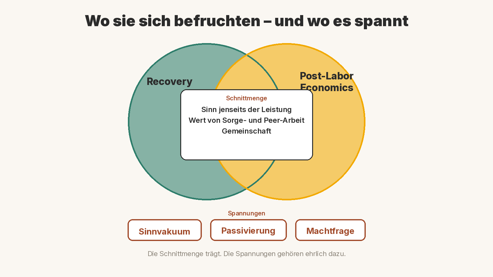

# Recovery und Post-Labor Economics

*Können sich Genesung und eine Ökonomie nach der Lohnarbeit gegenseitig befruchten?*

Was, wenn der Job nicht mehr der einzige Weg zu Einkommen, Status und Identität ist? Und was, wenn genau das Menschen in Recovery schon lange üben – oft nicht aus Theorie, sondern aus Notwendigkeit?

Diese Frage stellt sich, wenn zwei Denkweisen aufeinandertreffen, die selten in einem Satz vorkommen: Recovery, die Praxis der Genesung, und *Post-Labor Economics*, ein Modell des Autors David Shapiro. Was folgt, ist *unsere* Einordnung. Shapiro schreibt über Automatisierung, Haushaltseinkommen und Eigentum – nicht über psychische Gesundheit. Recovery beschreibt einen Weg zurück ins Leben – nicht die Zukunft der Wirtschaft. Ob sie sich befruchten können, ist ein Denkanstoß, kein Beweis.

## Was Post-Labor Economics meint

Laut Shapiro beschreibt Post-Labor Economics einen Umbau der Wirtschaft, in dem künstliche Intelligenz und Automatisierung die Kosten menschlicher Arbeit weitgehend bedeutungslos machen. Menschliche Arbeit wäre dann kein begrenzender Faktor der Produktion mehr. Wachstum und Wohlstand könnten sich von der Lohnarbeit *entkoppeln*.

Das erzeugt, was Shapiro das *Economic Agency Paradox* nennt: Die Produktion wird effizienter – aber wenn Löhne wegbrechen, fehlt vielen Haushalten die Kaufkraft. Seine Leitfrage lautet deshalb: Wie kommt Geld in die Haushalte?

Einkommen, so Shapiro, kommt im Wesentlichen aus drei Quellen: Löhnen, staatlichen Transfers und Kapitaleinkommen aus Eigentum. Fällt die erste Quelle weg, müssen die anderen tragen. Ein bedingungsloses Grundeinkommen hält er für *notwendig, aber nicht hinreichend* – weil eine Gesellschaft, die nur von staatlichen Zahlungen abhängt, politisch verwundbar bleibt. Deshalb will er Eigentum breiter streuen: Staatsfonds, Genossenschaften, Belegschaftsanteile, Treuhandmodelle, sogenanntes *Universal Basic Capital*. Transfers als Boden, Beteiligung als Wachstum.

Das ist ein Entwurf, kein Gesetz der Natur. Shapiro selbst behandelt vieles davon als offene Zukunft, nicht als ausgemachte Sache. Entscheidend für uns ist die Richtung: Überleben und Würde sollen nicht mehr allein am Verkauf der eigenen Zeit hängen.

## Was Recovery meint

Recovery ist, in den Worten von William Anthony aus dem Jahr 1993, ein zutiefst persönlicher Prozess: Einstellungen, Werte, Gefühle, Ziele, Fähigkeiten und Rollen ändern sich. Es ist eine Weise, ein zufriedenstellendes, hoffnungsvolles und beitragendes Leben zu führen – auch mit den Einschränkungen einer Erkrankung. Recovery bedeutet, neuen Sinn und Zweck zu entwickeln, über die erschütternden Folgen psychischer Krankheit hinaus.

Patricia Deegan, selbst Psychologin und Erfahrungsexpertin, beschrieb Recovery schon 1988 als gelebte Erfahrung: Menschen gewinnen ein neues Selbst- und Zweckgefühl *innerhalb und jenseits* der Grenzen einer Behinderung zurück. Es ist kein gerader Weg.

Dazu gehört das, was Robert Granfield und William Cloud um 1999 *Recovery Capital* genannt haben: die inneren und äußeren Ressourcen, mit denen jemand Genesung beginnen und aufrechterhalten kann – persönlich, sozial, in der Gemeinschaft, auch finanziell. Mehr dazu in unserem Beitrag [Recovery Capital als integratives Rahmenwerk](/posts/recovery-capital/).

Recovery sagt damit etwas, das über Symptome hinausgeht: Du bist mehr als deine Leistung. Du kannst beitragen, auch wenn du gerade keinen Job hast.

## Wo sie sich befruchten

Hier beginnt die eigene Lesart.

**Identität jenseits der Leistung.** Im Lohnarbeitsmodell hängt oft alles am Job: Geld, Ansehen, das Gefühl, jemand zu sein. Fällt der Job weg – durch Krise, Erkrankung, Automatisierung – bricht vieles gleichzeitig. Recovery übt seit Jahrzehnten eine andere Identität: nicht als defizitärer Patient, sondern als Mensch auf einem Weg, der anderen etwas zu geben hat. Peers sind Erfahrungsexpertinnen und -experten. Ihr Wissen zählt, weil sie etwas durchlebt haben, nicht weil ein Markt sie gerade braucht.

**Recovery Capital als Maß für Wohlstand.** Wenn Shapiro fragt, wie Haushalte Einkommen sichern, fragt Recovery, welche Ressourcen ein Leben tragen. Geld gehört dazu. Aber auch Beziehungen, Hoffnung, Selbstwirksamkeit, eine Gemeinschaft, die dich hält. In einer Zeit, in der der Job weniger selbstverständlich ist, könnte Recovery Capital ein vollständigeres Bild von Wohlstand sein als allein der Lohnzettel.

**Wert jenseits des Jobs.** Peer-Arbeit, Selbsthilfe, Sorgearbeit, das stille Dasein füreinander: All das schafft Sinn und Zusammenhalt, wird aber selten als „richtige Arbeit“ bezahlt. Eine Post-Labor-Gesellschaft, die Einkommen anders organisiert, hätte die Chance, diesen Wert sichtbar zu machen – nicht als Trostpreis, sondern als Bestandteil eines gelingenden Lebens. Weniger Druck, sich über Leistung zu beweisen, könnte auch Stigma lindern: Wer nicht arbeitet, wäre dann nicht automatisch „weniger wert“.

## Wo die Spannung liegt

Es wäre unehrlich, nur die Schnittmenge zu sehen.

**Sinnvakuum und Isolation.** Fällt die Struktur des Jobs weg, ohne dass etwas Tragfähiges an ihre Stelle tritt, droht Leere. In der [Dramaturgie der Genesung](/posts/dramaturgie-der-genesung/) haben wir beschrieben, wie äußere Stressoren und innere Isolation einander verstärken können. Shapiro spricht selbst von einer „Meaning Economy“: Menschen zahlen für echte Begegnung, Erfahrung, Verantwortung. Das ist ein Hinweis, kein Automatismus. Bedeutung entsteht nicht von selbst, nur weil Maschinen mehr produzieren.

**Passivierung – eine Anstalt ohne Mauern.** Recovery kennt die Gefahr, dass Fürsorge entmündigt: versorgt werden, ohne mitentscheiden zu dürfen. Shapiro warnt vor einer Gesellschaft, in der Menschen nur Empfänger staatlicher Zahlungen sind, deren Hahn sich zudrehen lässt. Eine Post-Labor-Ordnung, die nur alimentiert und nicht beteiligt, wäre eine Anstalt ohne Mauern – sicher vielleicht, aber ohne Würde.

**Die Machtfrage.** Wer besitzt die Maschinen und die KI? Wer entscheidet, wem die Erträge gehören? Shapiro macht daraus den Kern seiner Politik: Eigentum muss breiter werden, sonst konzentriert sich der Gewinn. Für Gemeinschaften ist das keine Abstraktion. In unserem Beitrag über [Fedi und die Privatsphäre von Bitcoin](/posts/fedi-privatsphaere/) geht es um eine Form gemeinschaftlicher Teilhabe: eine Gruppe, die Werte gemeinsam verwahrt, statt sie einer einzelnen Instanz zu überlassen. Das ist kein fertiges Modell für eine ganze Volkswirtschaft. Aber es zeigt die Richtung: Beteiligung statt bloßer Abhängigkeit.

## Fazit

Recovery und Post-Labor Economics kommen aus verschiedenen Welten. Die eine fragt, wie Menschen nach einem Einbruch wieder Sinn, Zugehörigkeit und Handlungsfähigkeit finden. Die andere fragt, wie eine Gesellschaft Einkommen und Mitsprache organisiert, wenn menschliche Arbeit nicht mehr der Engpass ist.

Sie können einander befruchten, wenn wir beides ernst nehmen: dass Würde nicht am Job hängt – und dass Absicherung ohne Teilhabe zur Passivierung werden kann. Recovery wäre dann nicht nur ein persönlicher Weg, sondern ein Übungsfeld für eine Gesellschaft nach der Lohnarbeit: Identität jenseits der Leistung, Capital, das mehr umfasst als Geld, und Gemeinschaft, die trägt.

Ob das gelingt, hängt nicht an einem Modell. Es hängt daran, ob wir Menschen als Beteiligte behandeln, nicht als Restgröße.

**Ausdrücklicher Hinweis:** Dieser Text ist eine Einordnung, keine Prognose und keine wirtschafts- oder sozialpolitische Handlungsanweisung.

> **Wenn es dir gerade sehr schlecht geht:**
> Notruf **112** · TelefonSeelsorge **0800 111 0 111** oder **0800 111 0 222** (kostenlos, rund um die Uhr)

---

### Quellen

- David Shapiro: [What do I mean when I say „Post-Labor Economics“ anyways?](https://daveshap.substack.com/p/what-do-i-mean-when-i-say-post-labor), 17. November 2024
- David Shapiro: [The 7 Frameworks to Understand Post-Labor Economics](https://daveshap.substack.com/p/the-7-frameworks-to-understand-post), 18. März 2026
- David Shapiro: [Post-Labor Economics Update](https://daveshap.substack.com/p/post-labor-economics-update) (Grundeinkommen notwendig, aber nicht hinreichend; eigentumsbasierte Einkommen)
- William Anthony: [Recovery from Mental Illness: The Guiding Vision of the Mental Health Service System in the 1990s](https://www.psychrehabassociation.org/sites/default/files/series-documents/bill_anthony_recovery_article.pdf), *Psychosocial Rehabilitation Journal* 16(4), 1993, S. 11–23
- Patricia Deegan: Recovery: The lived experience of rehabilitation, *Psychosocial Rehabilitation Journal* 11(4), 1988, S. 11–19; zitiert u. a. bei [Definitions of Recovery](https://recoverycontextinventory.com/what-is-mental-health-recovery/definitions-of-recovery/)
- Robert Granfield und William Cloud: *Coming Clean: Overcoming Addiction without Treatment*, New York University Press, 1999; zugänglich zusammengefasst in William L. White und William Cloud: [Recovery Capital: A Primer for Addictions Professionals](https://www.naadac.org/assets/2416/whitewlcloudw2008_recovery_capital_a_primer.pdf), *Counselor* 9(5), 2008
