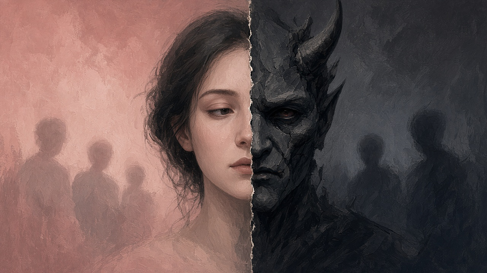

# Die Psychologie der Verteufelung: Was die Forschung über Belief in Pure Evil (BPE) und verwandte Prozesse sagt

Warum sehen wir manche Menschen als „reine Böse“ – und was steckt psychologisch dahinter?

Verteufelung (demonization) ist die Tendenz, andere als Verkörperungen reinen Bösen zu betrachten. In der Sozialpsychologie wird dies als extreme Form der Entmenschlichung untersucht. Die Forschung zeigt, dass sowohl situative Faktoren als auch individuelle Überzeugungen eine zentrale Rolle spielen.

## Prototypische Bösartigkeit und kognitive Belastung

Eine klassische Studie von van Prooijen und van de Veer (2010) demonstrierte, dass Menschen Täter besonders stark verteufeln, wenn deren Beschreibung einem prototypischen „Bösewicht“-Schema entspricht (emotionslos, sozial isoliert, antisozial). Dieser Effekt verstärkt sich unter kognitiver Belastung. Wenn mentale Ressourcen knapp sind, greifen wir stärker auf stereotype Böse-Schemata zurück. Verteufelung wird hier als extreme Form der Entmenschlichung verstanden, bei der Täter als intrinsisch und nicht-menschlich böse wahrgenommen werden.

## Belief in Pure Evil (BPE)

Russell Webster, Donald Saucier und Kollegen haben das Konstrukt **Belief in Pure Evil (BPE)** entwickelt. Personen mit hohem BPE sehen Böses als stabil, sadistisch, unveränderlich und von außen kommend. Sie verteufeln Täter stärker und befürworten härtere Strafen – oft unabhängig davon, ob der Täter tatsächlich stereotyp böse dargestellt wird. BPE vermittelt den Zusammenhang zu Bestrafung über stärkere Verteufelung und retributive Gefühle. Hohes BPE korreliert auch mit aggressiveren Einstellungen gegenüber Außengruppen und geringerer Bereitschaft zu prosozialen Maßnahmen.

## Just-World-Beliefs und Polarisierung

Der Glaube an eine gerechte Welt führt nicht nur zur Abwertung von Opfern, sondern auch zur Verteufelung von Tätern, insbesondere wenn situative Hinweise die Bösartigkeit des Täters nahelegen. In der Polarisierung zeigen Studien wie die von Decker und Lord (2023) zu „Self-Polarization“, dass die Attribution von Persönlichkeitseigenschaften an Personen, die einer eigenen Position widersprechen, dazu führt, dass Andersdenkende stärker verteufelt werden. Dies verstärkt polarisierte Einstellungen.

## Entmenschlichung und Intergruppenkonflikte

Verteufelung überlappt stark mit (blatanter) Entmenschlichung. Arbeiten von Haslam, Kteily und anderen zeigen, dass Gruppen als weniger menschlich wahrgenommen werden, was Gewaltbereitschaft und moralische Ausschließung erleichtert. In eskalierenden Konflikten dient Verteufelung der Abgrenzung und Rechtfertigung von Feindseligkeit und blockiert Kompromisse.

## Eine alternative Perspektive

Nahi Alon und Haim Omer beschreiben in ihrem Buch *The Psychology of Demonization* Prozesse wie ständiges Misstrauen und Eskalationsbereitschaft. Als Gegenkonzept schlagen sie eine „tragische Sicht“ vor: Leiden als Ergebnis vieler Faktoren, begrenzte Kontrolle, keine dämonischen Masterpläne. Diese Sicht fördert Akzeptanz und Deeskalation.

## Fazit

Verteufelung wird begünstigt durch prototypische Böse-Schemata, individuelle Unterschiede wie hohen Belief in Pure Evil, Gruppenprozesse und funktionale Motive (Rechtfertigung von Bestrafung, Aufrechterhaltung von Weltbildern). Die Forschung hilft zu verstehen, warum wir andere so leicht als „böse“ abtun – und wie wir dem entgegenwirken können.

---

*Dieser Beitrag basiert auf einer Zusammenfassung sozialpsychologischer Forschung zu Verteufelung und Belief in Pure Evil.*
